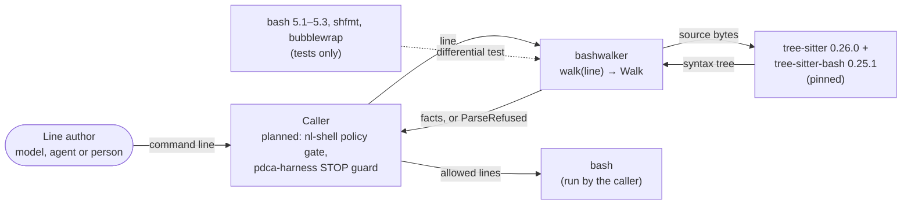

# 3. Context and scope

> Living document. The system from outside. Open questions are marked **[OPEN]** inline.

## 3.1 System context

The C4 source is [`diagrams/c4-context.mermaid`](diagrams/c4-context.mermaid).

## 3.2 External interfaces

| Interface | Direction | Trust |
|---|---|---|
| `walk(line, limits)` | caller → bashwalker | The line is untrusted: every byte may come from an adversary (§14.2). The limits are the caller's. |
| `Walk`, `Invocation` and the other fact types | bashwalker → caller | A proven fact holds for bash. A worst-case fact (untrusted tree, non-literal word, `unknown` stdin) must be treated as the worst case for the caller's rules. |
| `ParseRefused` | bashwalker → caller | Fixed text that never quotes the input. The caller treats it as "cannot judge". |
| `command_head`, `may_rewire_stdin` | bashwalker → caller | Read the facts of a `Walk`'s invocations, with the same guarantees. |
| `lex_word`, `make_word`, `untrusted_features`, `parse_source` | bashwalker → caller | Low-level parts of the walk with narrower contracts. `parse_source` applies no `Limits` and no trust rules; `untrusted_features` lacks the checks that need the whole walk (arithmetic, variables bash runs as code). Only `walk()` gives the full guarantee. |
| tree-sitter and tree-sitter-bash | bashwalker → library | Trusted at the exact pin. A grammar release is reviewed before the pin moves (§14.3). |
| bash, shfmt, bubblewrap | test → tools | Oracles in the differential test only, never at run time. |

## 3.3 Out of context

bashwalker never:
- starts bash or any other process;
- reads the environment, the filesystem or the caller's shell;
- touches the network;
- writes a log.

Redirect targets, paths and variable names are reported as text. Resolving them at run time
is up to the caller.
