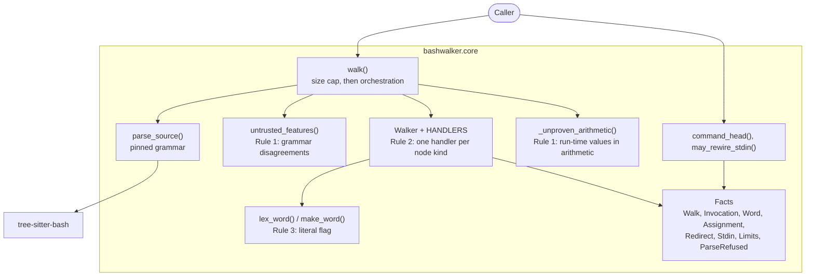

# 5. Building block view

> Living document. The components and what each is responsible for. Open questions are marked **[OPEN]** inline.

## 5.1 Components

The package is `src/bashwalker/`. `__init__.py` re-exports the public API, and `core.py`
holds the walker in sections that follow the rules.

| Component | Responsibility | Safety-critical |
|---|---|---|
| `walk()` | Refuses oversized input before parsing; runs the rules in order; applies the checks that need the whole walk (a variable bash runs as code, assigned text holding a substitution, no stdin fact from an untrusted tree) | Yes |
| `parse_source()` | The one entry point to the pinned grammar | Yes |
| `untrusted_features()` | Rule 1: `ERROR` and `MISSING` nodes and every form the grammar reads differently from bash (§14.5) | Yes |
| `Walker`, `HANDLERS`, `_check_walk()` | Rule 2: visits every named node once; builds one `Invocation` per simple command; refuses when a node or command is missed or a budget runs out | Yes |
| `lex_word()`, `make_word()` | Rule 3: quote removal as bash does it; a word is literal only with no expansion, glob, brace, tilde or decoding | Yes |
| `Stdin` and the stdin logic in `Walker` | Rule 3: stdin is `terminal`, `pipe` or `literal` only for the listed forms, else `unknown` | Yes |
| `_unproven_arithmetic()` | Rule 1 for arithmetic: untrusted unless every arithmetic context holds literal numbers (#12) | Yes |
| `command_head()`, `may_rewire_stdin()` | The command that runs after `command`, `builtin` and `time` prefixes; whether a command can change the shell's own stdin | Yes |
| Fact types | `Invocation`, `Word`, `Assignment`, `Redirect`, `Stdin` and `Limits` are frozen dataclasses; `Walk` is a plain dataclass whose lists the walk fills. No behaviour | No, but their meaning is the API |

## 5.2 Build-time components

None of these ship in the package:

| Component | Purpose |
|---|---|
| `tests/test_core.py` | Unit and abuse-case tests for every rule (§14.6). Covers the arithmetic cases that run in bash (`ARITHMETIC_SINKS`) and the cases flagged even though they are safe (`ARITHMETIC_UNPROVEN`). |
| `tests/test_differential.py`, `tests/oracle.py`, `tests/differential/known.toml` | The differential test: generated lines checked against `bash -n`, shfmt and bash's own reprint in bubblewrap (§8.5) |
| `scripts/build_bash.py` | Builds bash 5.1–5.3 from source for the differential job |
| `scripts/repo-settings.py` | Checks and applies the repository's GitHub settings and branch protection |
| `.github/triage/` | The issue triage bot (ADR-0005) |
| `.pre-commit-config.yaml`, `.secret-guard/` | Refuses to commit machine-local Claude Code settings and secrets (§14.8) |
