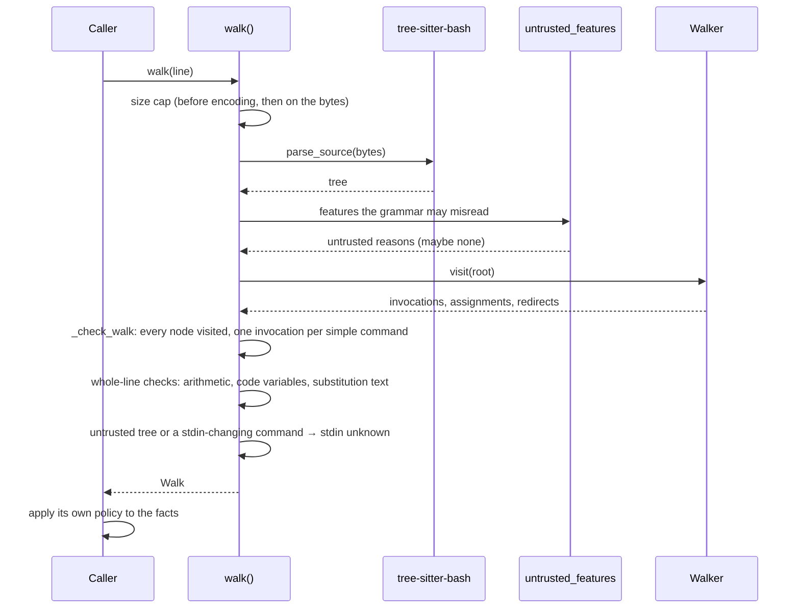

# 6. Runtime view

> Living document. How the components work together on the important paths. Open questions are marked **[OPEN]** inline.

## 6.1 The main path

A caller checks one command line before it runs.

The caller reads `walked.untrusted` first. An empty tuple means the tree is trusted and the
facts hold. Otherwise the caller treats the whole line as the worst case for its rules:
For example, an interactive shell asks for confirmation, and an agent's guard blocks.

## 6.2 Other important paths

- **Refusal.** These raise `ParseRefused` with fixed text:
  - input over `max_input_bytes`, checked before parsing;
  - a walk over `max_work` nodes or `max_depth` levels;
  - a node the walk did not visit;
  - a simple command without exactly one invocation.

  The caller can't judge the line and must not run it unchecked.
- **Untrusted tree.** The walk still returns its facts, but every invocation's stdin is
  `unknown`, and the caller must not rely on any fact that would allow a command.
- **A command that may change the shell's own stdin.** `may_rewire_stdin` covers:
  - `exec` with a redirect;
  - `eval`, `source`, `.`, `fc`, `trap` and `alias`;
  - a builtin with a code option (`mapfile`/`readarray -C`, `complete`/`compgen -C`/`-F`,
    `bind -x`);
  - a non-literal command word.

  Every invocation's stdin then becomes `unknown`, because any of them may run after it.
- **Code bashwalker cannot see.** `eval`, `source`, `.`, `fc`, `trap`, `alias` and a
  non-literal command word are reported as commands, not as what they will run
  (`SHELL_RUNNERS`, `CODE_LATER`). A caller that must know treats them as opaque (§14.8).
- **Prefixes.** `command_head()` looks through `command`, `builtin`, and the reserved
  `time` with its options and assignments. It returns the word that runs, or `None` for
  `command -v`. A prefix option it can't read gives the non-literal word as the head, which
  is the worst case.
